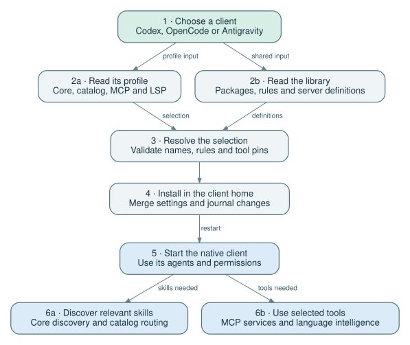

# SAGE

SAGE gives Codex, OpenCode and Antigravity a shared library of skills, MCP services and language-server definitions. A small profile selects the capabilities each client uses. The native client controls its agents, models, delegation and permissions.

[Browse the functional index](library/INDEX.md) · [Find token-saving tools](library/INDEX.md#token-savings-and-context) · [Follow the numbered architecture](docs/architecture/README.md)



## Find a capability

The index links each capability to its implementation, explains when to use it and shows its status in all three profiles. For example, the token savings group covers targeted retrieval, shorter tool output and checkpoints for long sessions.

```sh
python3 sage.py index token saving
python3 sage.py index explicit --client codex
python3 sage.py index language --client opencode
python3 sage.py show codex
```

Core skills are available at startup. Catalog skills can match a workspace or a prompt. Entries marked **explicit** require a direct request. For example, “Stress-test this plan” selects `red-team`. “Run a design interview” selects `grill-with-docs` and its two companion skills. MCP services can be enabled by default or offered as explicit opt-ins. OpenCode uses native LSP registrations. Codex and Antigravity can provision the selected executables and use Serena with its own project language settings.

## Install

Use Python 3.11 or newer from a stable checkout. Codex activation also uses the installed Codex CLI to merge TOML through its native configuration writer.

```sh
python3 sage.py check
python3 sage.py install codex --dry-run
python3 sage.py install codex
python3 sage.py doctor codex
```

Replace `codex` with `opencode` or `antigravity` to activate that client. Restart it after activation. To try an install in isolation, supply `--home /path/to/test-home` to both `install` and `doctor`. Each install prints a private restore journal. Run `python3 sage.py restore /path/to/journal.json` to return the affected files to their previous state.

| Option | Effect |
| --- | --- |
| `install CLIENT --mcp NAME` | Enable an optional MCP listed in that client's profile. |
| `install CLIENT --all-skills` | Make all selected skills visible at startup. |
| `lsp CLIENT --check` | Check the executables selected by the profile. |
| `lsp CLIENT --install --prefix PATH` | Provision selected language servers under a prefix. Put its `bin/` on the client's PATH. |
| `install opencode --base-url URL` | Explicitly select the local OpenAI-compatible provider defaults for a fresh configuration. `--key` supplies its key. |
| `python3 library/scripts/install_rtk.py --client CLIENT` | Install the optional pinned RTK terminal-output filter. |

## Tune and maintain

| Location | What to change |
| --- | --- |
| [Client profiles](clients/) | Set `core`, `catalog`, `mcp`, `optional_mcp` and `lsp` in the relevant `profile.json`. |
| [Skills](library/skills/) and [routing rules](library/routing.json) | Edit one package for every client selecting it. A profile can override that client's routing signals. |
| [Functional groups](library/functions.json) | Give each capability a purpose and one primary group. |
| [MCP services](library/mcp/servers.json) and [language servers](library/lsp/servers.json) | Edit native transports, commands, extensions and package pins. |
| [Optional specialist briefs](library/agents/) | Read a brief in the current session or supply it to a native agent of your choice. Briefs are plain Markdown and activate manually. |
| [Evaluation cases](evals/README.md) | Compare a profile change on a fixed workload. |

The checkout contains ordinary files. The installer links selected skill directories in the client home directly to the library, so a skill edit has one source. Keep the checkout at a stable path and rerun installation after changing selections or moving it. For machine-local skill packages, use the ignored `clients/<client>/skills.local/<name>/` overlay.

For an existing deployment, rerun `install` once after updating the checkout to this layout. An upgrade uses the install journals to retire earlier agent overrides and recover any personal agent files they replaced. If you restore a journal that points to older source paths, use the corresponding checkout revision to resolve those paths.

After editing a capability or profile, run `python3 sage.py sync` to refresh the index and `python3 sage.py check` to validate selections, detect duplicate registrations and verify package integrity. Run `python3 sage.py eval-routing` to replay the labeled requests against all three profiles. [Routing evaluations](evals/README.md) · [Architecture and verification](docs/architecture/README.md)
