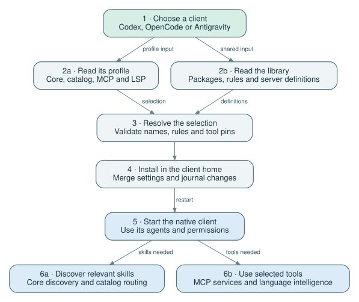

# SAGE architecture

Start with view 1. Inside each diagram, follow the arrows from step 1. Steps with the same number and different letters share a stage. The arrow labels identify a choice, independent inputs or an optional operation. Numbers restart in each view.

| View | Question | Diagram |
| --- | --- | --- |
| 1 | How does a profile become a working native session? | [Overview](overview.svg) |
| 2 | Where do I add a capability and choose its clients? | [Selection](selection.svg) |
| 3 | What does activation write, and how do I undo it? | [Installation and restore](activation.svg) |
| 4 | How does a skill become available during a session? | [Skill discovery](routing.svg) |
| 5 | When does the client use an MCP or start a language server? | [Language tools](language-tools.svg) |

Open the HTML viewer from a local checkout for clickable diagrams, source evidence and full-size SVGs. The SVG links above also work in repository browsers. [Offline viewer](index.html) · [Functional index](../../library/INDEX.md) · [Profile and installation contracts](../profiles.md)

## Update the diagrams

Edit the relevant DOT file and its evidence in `workflow.json`. Run `python3 sage.py graph` with Graphviz on PATH. Run `python3 sage.py graph --check` to verify numbering, links, previews and the offline viewer. The check also works without Graphviz installed. [Workflow graph skill](../../library/skills/workflow-graph/SKILL.md)
